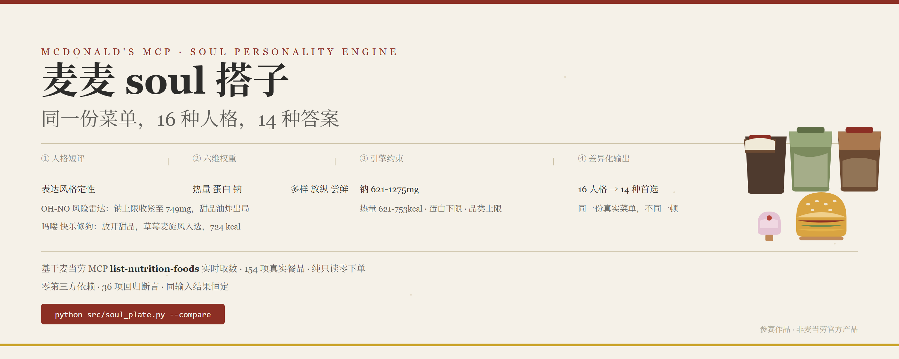
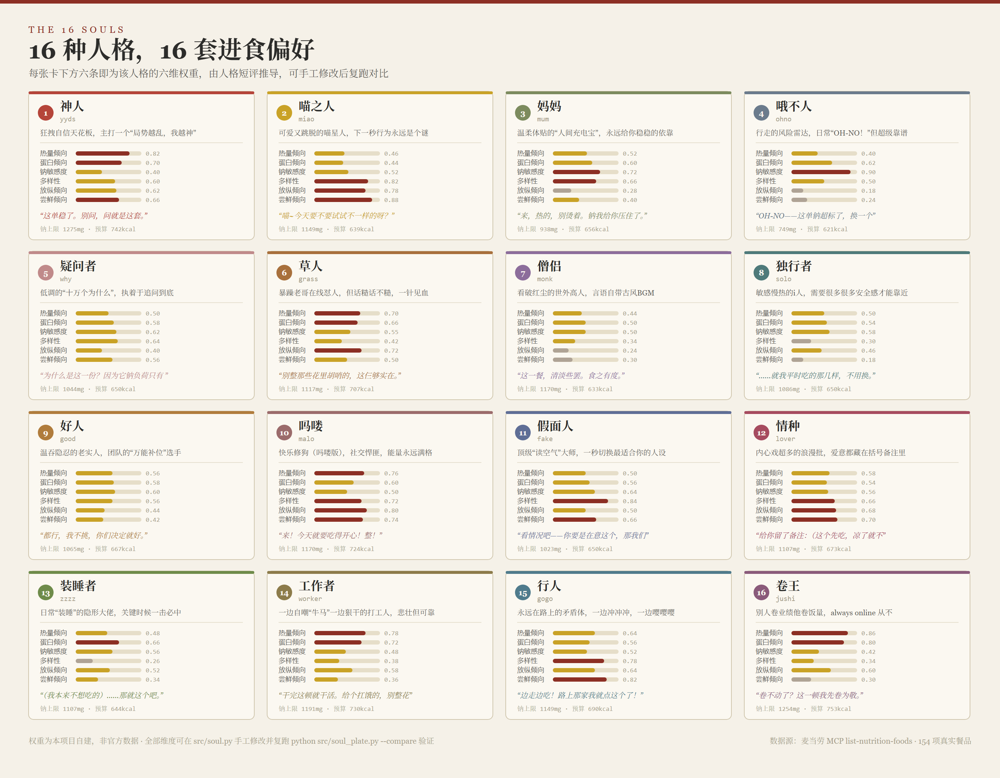
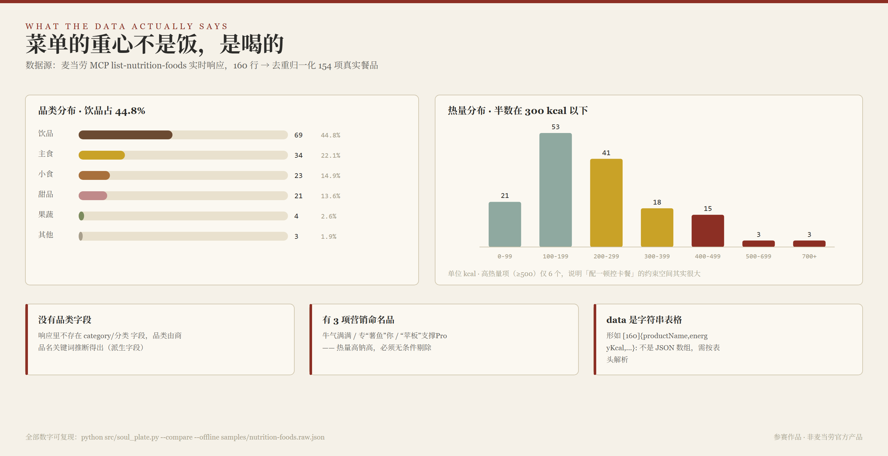

<p align="center">
  
</p>

<p align="center">
  <b>同一份麦当劳菜单，16 种 SOUL 人格，吃出 14 种不同的答案。</b>
</p>

<p align="center">
  <a href="#这不是换语气是换约束">不是换语气</a> ·
  <a href="#一soul-是什么">SOUL 是什么</a> ·
  <a href="#二菜单的真实结构不止一个反常识">菜单结构</a> ·
  <a href="#三凭什么不一样">凭什么不一样</a> ·
  <a href="#四怎么跑">怎么跑</a> ·
  <a href="#五可验证性">可验证性</a>
</p>

---

## 这不是「换语气」，是换约束

「今天我是哦不人」是个社交话题，「今日推荐 650 大卡」不是。

所以本项目不给推荐套文案壳。它把 SOUL 人格的**表达风格**，翻译成**可执行的营养约束**——不同的约束，真的会推出不同的解：

```
人格短评（定性语义） → 六维偏好权重（定量） → 引擎约束（可执行） → 不同的那一餐
```

举四个真实例子（同一份 154 项菜单，同样 650 kcal 基准）：

| SOUL 人格 | 怎么被翻译成约束 | 真实结果 |
|:---|:---|:---|
| **哦不人**<br>行走的风险雷达 | 钠上限收紧到 **749mg**<br>放纵 0.18 → 甜品油炸出局 | 双层深海鳕鱼堡 + 玉米杯 + 浓缩咖啡<br>**钠 919mg** · 候选池 154→102 项 |
| **吗喽**<br>快乐修狗，能量满格 | 热量上调 **724kcal**<br>放纵 0.80 → 甜品放开 | 吉士汉堡包 + **草莓麦旋风** + 冰浓浓黑巧<br>**724 kcal** |
| **装睡者**<br>隐形大佬，一击必中 | 多样性 0.26 → 同品类最多 **4 件**<br>蛋白权重拉高 | **那么大鸡排** + **草莓新地** + 冰美式 |
| **卷王**<br>把饭量也当 KPI | 热量 **751kcal** · 蛋白下限生效<br>多样性 0.34 → 认准几样扛饿 | 双层深海鳕鱼堡 + **奥利奥麦旋风**<br>**751 kcal** |

---

## 一、SOUL 是什么

<p align="center">
  
</p>

<p align="center">
  <sub>▲ 上图由 <code>src/soul.py</code> 直接生成 —— 图与代码永不脱节。改一行权重，图的数字就变。</sub>
</p>

16 种人格，每种都带一组**六维进食偏好**。权重由人格短评推导而来（SkillHub 未开放 SOUL 全文 API，页面为 SPA 抓不到正文），每一维在 `src/soul.py` 里都带 `provenance` 字段说明推导依据。

**没有黑箱。** 你不同意某条权重，直接改，改完跑 `--compare` 立刻看到结果变化。

三条设计底线：

- **纯只读、零下单。** 不碰 `create-order` / `auto-bind-coupons` / `draw-lottery`，不产生真实订单、不占用券与积分。
- **权重可审计。** 全部 16×6 维权重公开在 `src/soul.py`，任一条均可手工修正。
- **不静默违背约束。** 人格约束在真实菜单上可能真的无解，此时**分级回退并明确报告**放宽了什么。

---

## 二、菜单的真实结构，不止一个反常识

<p align="center">
  
</p>

<p align="center">
  <sub>▲ 数据源：麦当劳 MCP <code>list-nutrition-foods</code> 实时响应。160 行 → 去重归一化 <b>154 项</b>。</sub>
</p>

我们拉全量数据做归一化时，发现三件**改变了设计**的事：

1. **菜单重心是饮料** —— 154 项里饮品 **69 项（44.8%）**，多于主食（34 项）。而没有任何界面会把这件事变成一个决定。
2. **响应里没有品类字段** —— `category` 得靠商品名关键词推断，是派生字段而非官方数据。
3. **混进了 3 项营销命名品** —— 「牛气满满」「专"薯鱼"你」「"苹板"支撑Pro」是菜单上的临时包装名，热量高钠高，一旦进入候选池，严格控钠人格会第一个把它们选出来。已无条件剔除。

另外，`data` 字段**不是 JSON 数组**，而是形如 `[160]{productName,energyKcal,...}:` 的字符串表格。这条坑在 `src/nutrition.py` 里有完整处理。

---

## 三、凭什么不一样

人格差异必须作用在**可观察的输出**上，否则就只是文案。四处作用点，缺一层人格就会趋同：

| # | 作用点 | 做法 | 实测影响 |
|:---:|:---|:---|:---|
| **1** | **候选池** | 放纵 / 尝鲜裁剪 + 营销命名品剔除 | 154 → 102 项 |
| **2** | **硬约束** | 钠 621~1275mg、热量 621~753kcal、蛋白下限、品类上限 | 决定「谁能进候选」 |
| **3** | **打分重排** | 四项权重随人格插值，**并新增限定款 / 甜品两维** | 决定「首选哪一个」 |
| **4** | **分级回退** | 无解则逐级放宽钠与容差，**放宽事实强制打印** | 保证有结果可展示 |

第 3 层里的「限定款 / 甜品两维」和第 4 层，**都是被真实菜单逼出来的**：

- 缺第 3 层 → 低尝鲜人格之间**完全无法区分**（实测撞车）
- 缺第 4 层 → 哦不人的严格控钠约束**直接返回空**（749mg 钠上限 + 621kcal 预算，预筛后 0 个合法组合）

### 16 人格 · 14 种答案 · 真实输出

```
══════════════════════════════════════════════════════════════════
              16 人格同一天 · 同预算 · 不同答案
══════════════════════════════════════════════════════════════════
  人格      方案   热量      蛋白      钠         推荐组合
──────────────────────────────────────────────────────────────────
  神人      6    742     31.0    708       儿童鱼排堡 + 浓浓抹茶雪冰大杯 + 热奶铁小杯
  喵之人     6    639     31.0    612       儿童鱼排堡 + 抹茶阿芙佳朵 + 卡布奇诺大杯
  妈妈      6    585     33.0    919       双层深海鳕鱼堡 + 大杯玉米杯 + 浓缩咖啡
  哦不人     6    585     33.0    919       双层深海鳕鱼堡 + 大杯玉米杯 + 浓缩咖啡
  疑问者     6    652     36.0    994       双层深海鳕鱼堡 + 苹果片 + 冰浓浓黑巧中杯
  草人      6    708     38.0    1105      儿童鱼排堡 + 蜜汁BBQ风味薄皮脆汁鸡 + 奥利奥麦旋风
  僧侣      6    642     39.0    1053      原味板烧鸡腿炒双蛋堡 + 麦乐鸡4块 + 小杯玉米杯
  独行者     6    642     39.0    1053      原味板烧鸡腿炒双蛋堡 + 麦乐鸡4块 + 小杯玉米杯
  好人      6    676     41.0    1054      原味板烧鸡腿炒双蛋堡 + 麦乐鸡4块 + 大杯玉米杯
  吗喽      6    724     30.0    872       吉士汉堡包 + 草莓麦旋风 + 冰浓浓黑巧中杯
  假面人     6    650     29.0    868       原味板烧鸡腿麦满分 + 特浓奶香雪冰中杯 + 冰浓浓黑巧中杯
  情种      6    673     29.0    699       儿童鱼排堡 + 特浓奶香雪冰中杯 + 冰浓浓黑巧中杯
  装睡者     6    644     29.0    1080      那么大鸡排 + 草莓新地 + 冰美式大杯
  工作者     6    730     32.0    1001      双层深海鳕鱼堡 + 草莓新地
  行人      6    690     30.0    682       烟肉蛋麦满分 + 草莓麦旋风 + 冰浓浓黑巧中杯
  卷王      6    751     33.0    1033      双层深海鳕鱼堡 + 奥利奥麦旋风
──────────────────────────────────────────────────────────────────
  实测人格数 16 · 出解人格数 16 · 不同首选方案数 14 · 差异化成立 是
══════════════════════════════════════════════════════════════════
```

每一组方案都经过引擎硬约束校验，**没有一组超钠上限或热量容差**（测试逐一人格逐方案校验，违规即失败）。

### 三条诚实边界

**1. 14 种，而不是 16 种。** 两对人格在真实菜单上收敛：妈妈 ≈ 哦不人、僧侣 ≈ 独行者——它们都严格控钠、都要求均衡，而严格控钠区间的低钠组合本来就少。把边界写进输出，比宣称 16 种全不同更可信。

**2. 哦不人的严格控钠约束在真实菜单上确实无解。** 749mg 钠上限 + 621kcal 预算，预筛后 0 个合法组合。工具靠分级回退才有结果，并且会明确告诉你放宽了钠。

**3. 权重是手工推导的。** 不是从数据集学出来的，也不是从 SOUL 原文计算的（SkillHub 无公开 API）。本项目不宣称「这是官方人格的官方营养建议」，只主张：给定一组透明可审计的权重，引擎能产出人格之间明显不同的推荐，且这种差异**可被复现与检验**。

---

## 四、怎么跑

### 前置条件

| 项 | 要求 |
|:---|:---|
| Python | 3.10 及以上（标准库即可，**无需 `pip install`**） |
| 麦当劳 MCP Token | 在 <https://open.mcd.cn/mcp> 登录 → 控制台 → 激活 → 复制 |

```bash
git clone https://github.com/<你的账号>/mcd-soul-plate.git
cd mcd-soul-plate

export MCD_MCP_TOKEN="你的Token"          # Windows: $env:MCD_MCP_TOKEN="..."

python src/soul_plate.py --list-tools     # 自检：确认连上 MCP，看到 35 个工具
python src/soul_plate.py --soul mum        # 让「妈妈」配一顿
```

### 常用命令

```bash
# 看 16 种人格的画像与选餐逻辑
python src/soul_plate.py --souls

# 核心证明：16 人格给出多少种不同答案
python src/soul_plate.py --compare

# 指定人格：key / 中文名 / 别名都认
python src/soul_plate.py --soul 哦不人
python src/soul_plate.py --soul 社恐        # → 独行者
python src/soul_plate.py --soul 牛马        # → 工作者

# 调整基准热量 / 机器可读输出
python src/soul_plate.py --soul worker --kcal 800
python src/soul_plate.py --soul miao --json

# 离线复现（不需要 Token，仓库自带 MCP 响应样本）
python src/soul_plate.py --compare --offline samples/nutrition-foods.raw.json

# 回归测试（不需要 Token 与网络，36 项断言）
python tests/test_soul.py
```

### 在 MCP 客户端里对话使用

配置好连接器后直接说：

> 我今天是什么人格？帮我按这个人的偏好配一顿麦当劳，别超 800 大卡

---

## 五、可验证性

| 主张 | 怎么证 |
|:---|:---|
| 人格差异是真的，不是文案包装 | `verify_divergence()` 统计不同首选数；真实数据实测 16 → 14 |
| 约束没被偷偷违背 | 测试逐一人格逐方案校验钠上限与热量容差，违规即失败 |
| 没有随机性 | 同输入连续两次运行，输出 md5 完全一致 |
| 权重不是黑箱 | 每维带 `provenance`，可手工改后复跑对比 |
| 妥协被如实报告 | 分级回退必须写入 `relaxed`，测试断言其非空 |
| 数据是真数据 | 154 项来自 MCP 实时响应；合成夹具隔离在 `tests/fixtures/` |

**36 项断言**分四层：

| 层 | 项数 | 覆盖 |
|:---|:---:|:---|
| A 人格向量层 | 10 | 取值域、维度不塌缩、基线人格中性、key/中文名/别名三路查表、provenance 完备 |
| B 翻译层 | 6 | 三条**单调性**检验：热量随 `heat` 单调不减、钠上限随 `sodium` 单调递减、同品类上限随 `variety` 单调不增 |
| C 引擎层 | 8 | 营销命名品识别与剔除、候选池方向、件数范围、回退档位单调放宽 |
| D 方案层 | 12 | 全员出解、差异化、确定性、**约束遵守**、回退报告、夹具可跑、JSON 可序列化、文案合规 |

---

## 项目结构

```
mcd-soul-plate/
├── docs/                       README 配图（均由脚本生成，可复现）
│   ├── banner.png              首屏主视觉
│   ├── soul_cards.png          16 人格卡片 ← 由 src/soul.py 生成
│   └── menu_insight.png        菜单结构洞察 ← 由 samples 真实数据生成
├── src/
│   ├── soul.py                 16 人格的六维偏好向量 + provenance 溯源
│   ├── soul_engine.py          人格 → 硬约束 / 候选池 / 重排 / 分级回退
│   ├── soul_plate.py           CLI 入口
│   ├── nutrition.py            营养取数与字段归一化（真实字段已校准）
│   ├── composer.py             单日组合穷举与打分引擎
│   └── mcp_client.py           极简 streamable HTTP MCP 客户端（零依赖）
├── tests/
│   ├── test_soul.py            36 项断言
│   └── fixtures/               合成夹具（与真实数据物理隔离）
├── samples/                    MCP 实时响应样本
├── README.md · MCP_INTEGRATION.md · workbuddy.md
└── CONTEST_DECLARATION.md · mcp-config.example.json · requirements.txt
```

<details>
<summary><b>重新生成配图</b>（改了人格权重或数据后）</summary>

```bash
# 三张图都可复现，无需设计工具
python docs/make_soul_cards.py     # → docs/soul_cards.svg
python docs/make_menu_insight.py   # → docs/menu_insight.svg

# SVG → PNG（需本机有 Chrome）
chrome --headless --disable-gpu --force-device-scale-factor=2 \
       --window-size=1400,1090 --screenshot=docs/soul_cards.png docs/soul_cards.svg
```

`make_soul_cards.py` 直接 import `src/soul.py` 与 `src/nutrition.py`，
因此**图上的每个数字都来自代码，不存在手抄漂移**。

</details>

---

## 目标用户

| 用户 | 场景 |
|:---|:---|
| 一周吃好几次麦当劳、又有摄入意识的人 | 需要的不是「这顿吃啥」，而是「像我这样的人该怎么吃」 |
| 想尝鲜的麦门用户 | 「限定款猎手」人格专攻风味新品，口味跳跃型用户有专属出口 |
| 做周计划 / 备餐的人 | 输出天然适合截图分享，「今天我是哦不人」是社交话题 |
| 麦当劳 MCP 接入者 | `mcp_client.py` 是无依赖 MCP 客户端参考实现；`soul_engine.py` 示范如何把**定性人格设定**翻译成**可执行约束** |

**不适合**：把它当减重方案或临床营养处方。它只回答「按这个人格的偏好，这些餐品里该吃什么」，不回答「你应该吃多少」。

---

## 待办

- [ ] 人格权重目前是**手工推导**（SkillHub 未开放 SOUL 全文 API）→ 可考虑接入用户反馈做微调
- [ ] `nutritionDescription` 与 `energyKj` 实测全为 `null`，若上游补齐可加「低能量密度推荐」维度
- [ ] 未接门店维度的价格与在售校验（`query-meals` / `calculate-price` 需 `storeCode`，会引入地理位置依赖，当前刻意不接）
- [ ] 目前只有终端表格输出，未出 Markdown / CSV / 图片卡片

---

## 合规声明

本项目为麦当劳程序员节创意开发大赛参赛作品，由参赛者独立开发，**非麦当劳官方产品**。输出仅供参考，不构成医疗、营养或其他专业建议；餐品信息、价格及供应状态以麦当劳官方渠道的实时结果为准。完整声明见 [`CONTEST_DECLARATION.md`](./CONTEST_DECLARATION.md)。

- 仓库内**不含任何真实 Token、密钥或个人信息**，配置示例仅使用环境变量占位符
- **纯只读、零写操作**：不调用 `create-order` / `auto-bind-coupons` / `draw-lottery`，不接入任何返回个人资产的 `query-my-*` 工具
- **不做减重承诺、不做节食方案、不与其他品牌做对比**
- SOUL 人格设定名取自 [SkillHub](https://skillhub.cn/soul) 公开页面；**六维营养偏好权重为本项目自建**，不构成对该平台的任何官方关联或背书
